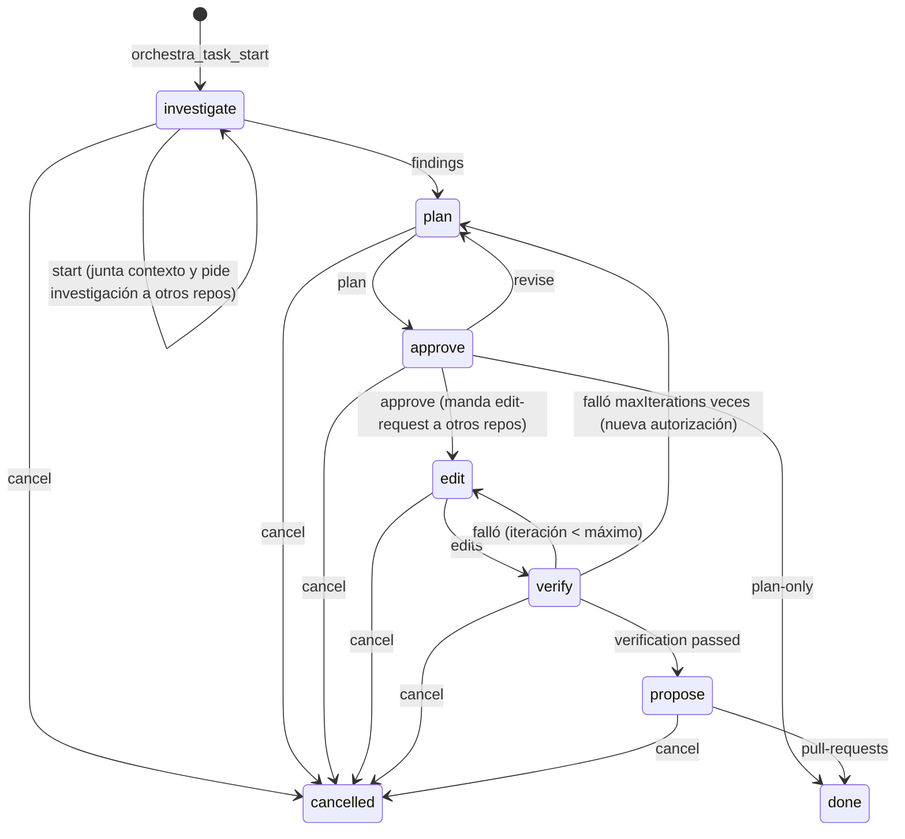

# Orquestación de tareas

## Principio

**LangGraph ordena; Claude Code razona.** El grafo no llama a ningún modelo. Cada nodo recibe lo que Claude reportó por una herramienta MCP, decide la siguiente fase, opcionalmente llama herramientas (recordar memoria, leer checkpoints, mandar mensajes) y devuelve una `instruction` en lenguaje natural para Claude.

## Fases

| Fase | Entrada esperada (`kind`) | Herramienta | Efecto |
| --- | --- | --- | --- |
| investigate | `start` | `orchestra_task_start` | Recuerda memoria y último checkpoint de cada repo. Manda `investigate-request` a los otros repos |
| investigate | `findings` | `orchestra_task_advance` | Pasa a plan |
| plan | `plan` | `orchestra_task_advance` | Pasa a approve |
| approve | `approval` | `orchestra_task_approve` | `approve` → edit (manda `edit-request`); `revise` → plan; `plan-only` → done |
| edit | `edits` | `orchestra_task_advance` | Pasa a verify |
| verify | `verification` | `orchestra_task_advance` | Pasa a propose, vuelve a edit, o vuelve a plan tras `maxIterations` (3) fallos |
| propose | `pull-requests` | `orchestra_task_advance` | done |
| cualquiera | `cancel` | `orchestra_task_advance` | cancelled |

Una entrada que no corresponde a la fase falla con `bad_request` y el mensaje dice qué se esperaba.

## Una invocación = un paso

`advanceTask` (`src/orchestration/runner.ts`):

1. Toma el lease de la tarea (`POST /v1/tasks/{id}/lease`). Si otro agente lo tiene vigente: `conflict`.
2. Ejecuta el grafo una vez: `START → route() → nodo de la fase actual → END`.
3. Guarda el nuevo estado con la versión leída (`PUT /v1/tasks/{id}`). Si alguien escribió antes: `conflict`.

El estado de la tarea **es** el estado del grafo, guardado en el backend. Por eso no hace falta un checkpointer de LangGraph y cualquier máquina con el lease puede ejecutar el siguiente paso. Ver [ADR 0004](../adr/0004-langgraph-sin-checkpointer.md).

## Rotación del orquestador

- Quien crea la tarea tiene el lease desde el inicio. Cada paso lo renueva por 10 minutos.
- Si esa máquina se duerme, otra puede tomarlo cuando expira. La acción queda registrada con su `agent` en `actions`.
- El agente anterior, al volver, recibe `conflict` y debe leer la tarea en lugar de pisarla.
- Una tarea cerrada (`done` o `cancelled`) libera el lease y no acepta más pasos.

## Agentes bidireccionales

Los nodos `investigate` y `approve` mandan mensajes a los otros repos. Del otro lado:

1. El monitor (`watch`) ve el mensaje nuevo y escribe una línea; Claude Code la recibe como notificación.
2. Ese Claude sigue la skill `orchestra`: investiga o edita (pidiendo confirmación local para editar), responde con `orchestra_send` al `fromRepo` con el mismo `taskId`, y hace `orchestra_ack`.
3. El orquestador lee las respuestas con `orchestra_inbox` y las incluye en `findings` o `edits`.

Cualquier repo puede mandar mensajes a cualquier otro, no solo el orquestador.

## Estado

`TaskGraphState` (`src/orchestration/state.ts`): `goal`, `repos`, `orchestratorRepo`, `phase`, `context` (memoria y checkpoint por repo), `findings`, `plan`, `approval`, `edits`, `verification`, `iterations`, `maxIterations`, `pullRequests`, `actions` (bitácora: nodo, agente, hora, nota) e `instruction`.

Todo texto del estado pasa por el enmascarado antes de guardarse.
