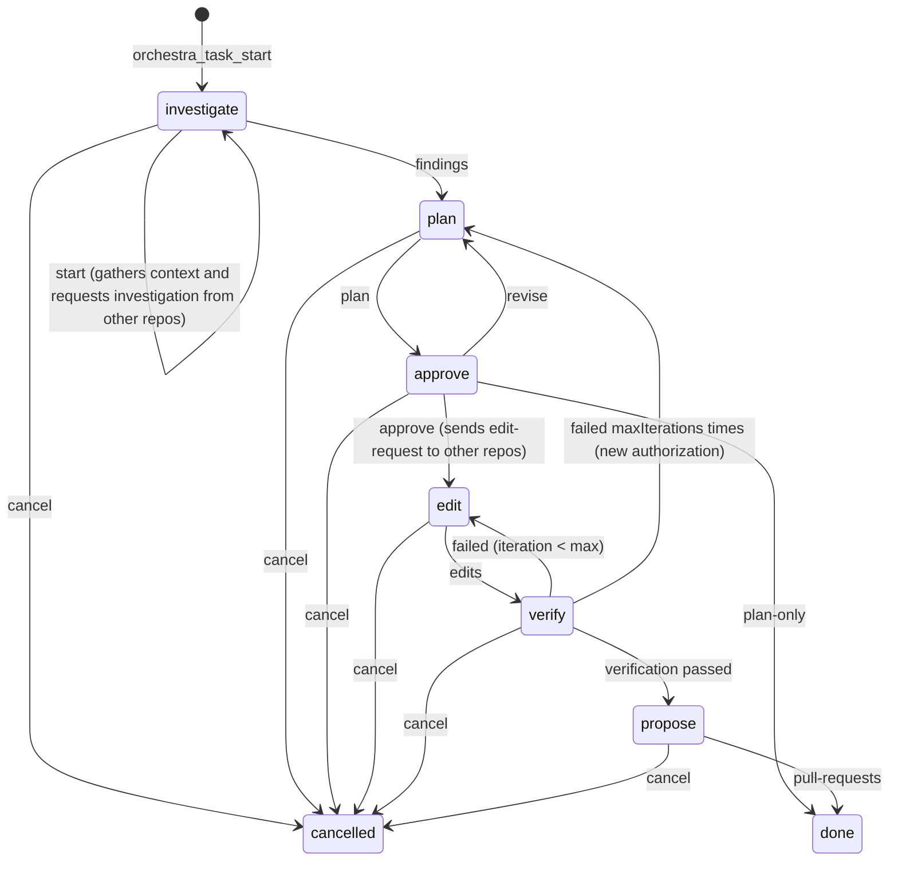

# Task orchestration

## Principle

**LangGraph sequences; Claude Code reasons.** The graph does not call any model. Each node receives what Claude reported through an MCP tool, decides the next phase, optionally calls tools (recall memory, read checkpoints, send messages), and returns a natural-language `instruction` for Claude.

## Phases

| Phase | Expected input (`kind`) | Tool | Effect |
| --- | --- | --- | --- |
| investigate | `start` | `orchestra_task_start` | Recalls memory and the latest checkpoint of each repo. Sends `investigate-request` to the other repos |
| investigate | `findings` | `orchestra_task_advance` | Moves to plan |
| plan | `plan` | `orchestra_task_advance` | Moves to approve |
| approve | `approval` | `orchestra_task_approve` | `approve` → edit (sends `edit-request`); `revise` → plan; `plan-only` → done |
| edit | `edits` | `orchestra_task_advance` | Moves to verify |
| verify | `verification` | `orchestra_task_advance` | Moves to propose, returns to edit, or returns to plan after `maxIterations` (3) failures |
| propose | `pull-requests` | `orchestra_task_advance` | done |
| any | `cancel` | `orchestra_task_advance` | cancelled |

An input that does not match the phase fails with `bad_request`, and the message says what was expected.

## One invocation = one step

`advanceTask` (`src/orchestration/runner.ts`):

1. Takes the task lease (`POST /v1/tasks/{id}/lease`). If another agent holds a valid lease: `conflict`.
2. Runs the graph once: `START → route() → current phase node → END`.
3. Saves the new state with the version it read (`PUT /v1/tasks/{id}`). If someone wrote first: `conflict`.

The task state **is** the graph state, stored in the backend. That is why no LangGraph checkpointer is needed, and any machine holding the lease can run the next step. See [ADR 0004](../adr/0004-langgraph-without-checkpointer.md).

## Orchestrator rotation

- The task creator holds the lease from the start. Each step renews it for 10 minutes.
- If that machine goes to sleep, another one can take the lease when it expires. The action is logged with its `agent` in `actions`.
- When the previous agent comes back, it gets `conflict` and must read the task instead of overwriting it.
- A closed task (`done` or `cancelled`) releases the lease and accepts no more steps.

## Bidirectional agents

The `investigate` and `approve` nodes send messages to the other repos. On the other side:

1. The monitor (`watch`) sees the new message and prints a line; Claude Code receives it as a notification.
2. That Claude follows the `orchestra` skill: it investigates or edits (asking for local confirmation before editing), replies with `orchestra_send` to the `fromRepo` with the same `taskId`, and calls `orchestra_ack`.
3. The orchestrator reads the replies with `orchestra_inbox` and includes them in `findings` or `edits`.

Any repo can send messages to any other repo, not just the orchestrator.

## State

`TaskGraphState` (`src/orchestration/state.ts`): `goal`, `repos`, `orchestratorRepo`, `phase`, `context` (memory and checkpoint per repo), `findings`, `plan`, `approval`, `edits`, `verification`, `iterations`, `maxIterations`, `pullRequests`, `actions` (log: node, agent, time, note) and `instruction`.

All text in the state goes through masking before it is saved.
