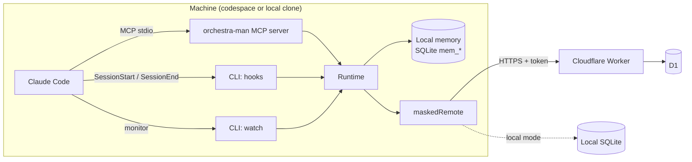

# Architecture

## Components



| Component | Code | Responsibility |
| --- | --- | --- |
| Contract | `src/core/contract.ts`, `src/core/routes.ts` | zod schemas and HTTP routes. Single source of truth |
| Service | `src/core/service.ts` | Business rules: validation, leases, optimistic versions, batches, tokens, maintenance |
| Repositories | `src/core/repositories/*` | Atomic SQL, one table per file |
| Worker | `src/worker/*` | HTTP, authentication, codespace wake, maintenance cron |
| Masking | `src/masking/*` | Rules and the `maskedRemote` decorator |
| Orchestration | `src/orchestration/*` | LangGraph graph and runner with lease |
| Memory | `src/memory/*` | Per-repo local memory: upsert by topic, versions, dedupe, FTS5, sessions, context |
| Plugin runtime | `src/plugin/*` | Config, identity, incremental sync, use cases, MCP and CLI |

## Ports and adapters

Two small interfaces decouple everything:

**`SqlDatabase`** (`src/core/db.ts`) is the subset of the D1 API that the data code uses: `prepare().bind().all()/first()/run()` and `batch()`.

- In the Worker, the D1 `env.DB` binding implements it as is.
- In local mode and in tests, `openNodeSqlite` (`src/core/node-sqlite.ts`) implements it on top of `node:sqlite`.

This way **all SQL exists only once** and runs the same on D1 and locally. There is also a single schema (`migrations/`): wrangler applies it to D1 and `applyMigrations` applies it to the local SQLite.

**`Remote`** (`src/core/remote.ts`) is what the plugin needs from the backend.

- `OrchestraService` implements it directly (local mode).
- `httpRemote` implements it against your Worker (D1 mode). The Worker, in turn, delegates to `OrchestraService`.
- `maskedRemote` decorates it: it masks all free text before delegating.

`createRuntime` (`src/plugin/runtime.ts`) is the composition root: the only place that picks concrete implementations. It always wraps the backend with `maskedRemote`.

```
plugin code ──► Remote (maskedRemote) ──► httpRemote ──HTTP──► Worker ──► OrchestraService ──► SqlDatabase = D1
                                      └─► OrchestraService ─────────────────────────────────► SqlDatabase = node:sqlite
```

The end-to-end tests run the same scenario through both paths and require identical results.

## Applied principles

- **Single responsibility**: repositories only speak SQL; the service only applies rules; the Worker only translates HTTP; graph nodes only decide the next step.
- **Open/closed**: new masking rules, MCP tools or routes are added to tables (`DEFAULT_RULES`, `TOOLS`, `ROUTES`/`HANDLERS`) without touching anything else.
- **Substitution**: any `Remote` or `SqlDatabase` works; the tests prove it with both backends.
- **Dependency inversion**: clock, ids, `fetch`, `exec` (git) and the local database are injected. No module calls `Date.now()` or creates singletons, except the entry points in `src/plugin/bin/`.

## Main flows

| When | What happens | Code |
| --- | --- | --- |
| Opening Claude Code | Opens the session, syncs memory, saves a checkpoint, and injects the repo memory and the cross-repo context | `sessionStart` in `src/plugin/commands.ts` |
| Compaction | Asks to save the compacted summary and re-injects memory | `postCompact` |
| Subagent finishes | Saves its "Key Learnings" | `subagentStop` |
| During the session | The monitor checks the inbox every `inboxPollSec` and prints one line per new message; every `checkpointIntervalSec` it repeats the sync | `watch` |
| MCP tools | Queries, messages and task steps | `src/plugin/mcp.ts` |
| Closing Claude Code | Final sync and checkpoint | `runCheckpoint` |
| Worker cron (daily) | Deletes expired messages and checkpoints and releases expired leases | `OrchestraService.maintenance` |

See also [orchestration.md](orchestration.md) and [memory-and-sync.md](memory-and-sync.md).
