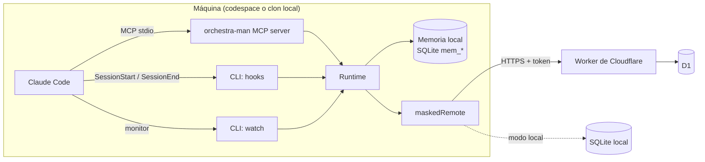

# Arquitectura

## Componentes



| Componente | Código | Responsabilidad |
| --- | --- | --- |
| Contrato | `src/core/contract.ts`, `src/core/routes.ts` | Esquemas zod y rutas HTTP. Fuente única de verdad |
| Servicio | `src/core/service.ts` | Reglas de negocio: validación, leases, versiones optimistas, lotes, tokens, mantenimiento |
| Repositorios | `src/core/repositories/*` | SQL atómico, una tabla por archivo |
| Worker | `src/worker/*` | HTTP, autenticación, wake de codespaces, cron de mantenimiento |
| Enmascarado | `src/masking/*` | Reglas y decorador `maskedRemote` |
| Orquestación | `src/orchestration/*` | Grafo de LangGraph y runner con lease |
| Memoria | `src/memory/*` | Memoria local de cada repo: upsert por tema, versiones, dedupe, FTS5, sesiones, contexto |
| Runtime del plugin | `src/plugin/*` | Config, identidad, sync incremental, casos de uso, MCP y CLI |

## Puertos y adaptadores

Dos interfaces pequeñas desacoplan todo:

**`SqlDatabase`** (`src/core/db.ts`) es el subconjunto de la API de D1 que usa el código de datos: `prepare().bind().all()/first()/run()` y `batch()`.

- En el Worker la implementa el binding `env.DB` de D1, tal cual.
- En modo local y en los tests la implementa `openNodeSqlite` (`src/core/node-sqlite.ts`) sobre `node:sqlite`.

Así **todo el SQL existe una sola vez** y se ejecuta igual en D1 y en local. El esquema (`migrations/`) también es uno solo: wrangler lo aplica a D1 y `applyMigrations` al SQLite local.

**`Remote`** (`src/core/remote.ts`) es lo que el plugin necesita del backend.

- `OrchestraService` lo implementa directamente (modo local).
- `httpRemote` lo implementa contra tu Worker (modo D1). El Worker, a su vez, delega en `OrchestraService`.
- `maskedRemote` lo decora: enmascara todo texto libre antes de delegar.

`createRuntime` (`src/plugin/runtime.ts`) es la raíz de composición: el único lugar que elige implementaciones concretas, y siempre envuelve el backend con `maskedRemote`.

```
plugin code ──► Remote (maskedRemote) ──► httpRemote ──HTTP──► Worker ──► OrchestraService ──► SqlDatabase = D1
                                      └─► OrchestraService ─────────────────────────────────► SqlDatabase = node:sqlite
```

Los tests end-to-end corren el mismo escenario por los dos caminos y exigen resultados idénticos.

## Principios aplicados

- **Responsabilidad única**: repositorios solo hablan SQL; el servicio solo aplica reglas; el Worker solo traduce HTTP; los nodos del grafo solo deciden el siguiente paso.
- **Abierto/cerrado**: nuevas reglas de enmascarado, herramientas MCP o rutas se agregan en tablas (`DEFAULT_RULES`, `TOOLS`, `ROUTES`/`HANDLERS`) sin tocar el resto.
- **Sustitución**: cualquier `Remote` o `SqlDatabase` sirve; los tests lo demuestran con ambos backends.
- **Inversión de dependencias**: reloj, ids, `fetch`, `exec` (git) y la base local se inyectan. Ningún módulo llama `Date.now()` ni crea singletons, salvo los puntos de entrada en `src/plugin/bin/`.

## Flujos principales

| Momento | Qué pasa | Código |
| --- | --- | --- |
| Abrir Claude Code | Abre la sesión, sincroniza la memoria, guarda un checkpoint e inyecta la memoria del repo y el contexto entre repos | `sessionStart` en `src/plugin/commands.ts` |
| Compactación | Pide guardar el resumen compactado y reinyecta la memoria | `postCompact` |
| Fin de un subagente | Guarda sus "Key Learnings" | `subagentStop` |
| Durante la sesión | El monitor consulta la bandeja cada `inboxPollSec` y avisa con una línea por mensaje nuevo; cada `checkpointIntervalSec` repite la sincronización | `watch` |
| Herramientas MCP | Consultas, mensajes y pasos de tareas | `src/plugin/mcp.ts` |
| Cerrar Claude Code | Última sincronización y checkpoint | `runCheckpoint` |
| Cron del Worker (diario) | Borra mensajes y checkpoints vencidos y libera leases expirados | `OrchestraService.maintenance` |

Ver también [orchestration.md](orchestration.md) y [memory-and-sync.md](memory-and-sync.md).
